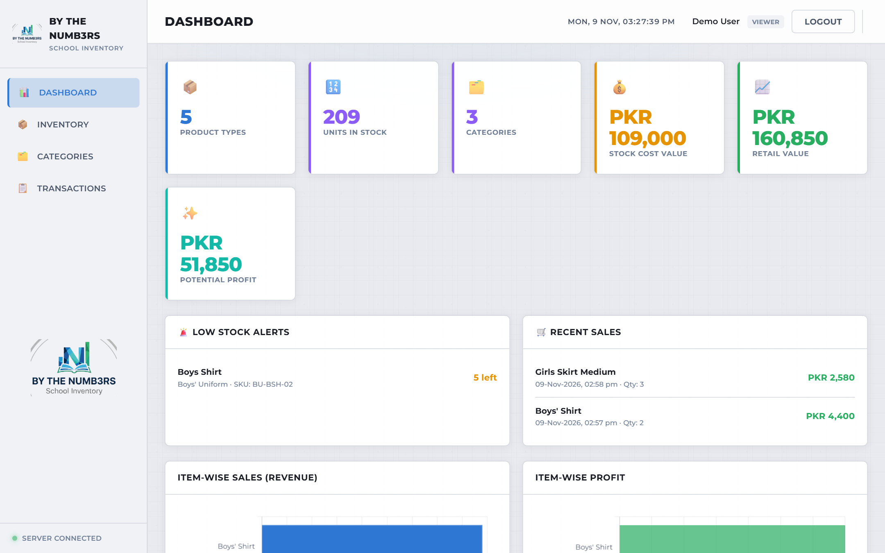
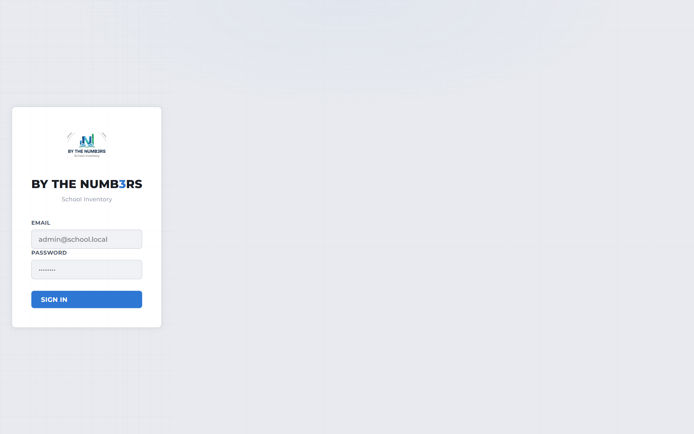

# School Inventory Management System — BY THE NUMB3RS

Inventory, sales and stock management for schools — uniforms, books and supplies.
Track stock levels, record sales, manage users with role-based access, and
white-label the app with the school's own name and logo.

**Live demo:** https://btn-school-inv-7dh1.vercel.app/login.html
**Demo login:** `demo@school.local` / `demo1234` (read-only VIEWER account — safe to use)



| Login | Inventory | Transactions |
| --- | --- | --- |
|  |  |  |

## Features

- **Dashboard** — product types, units in stock, stock cost value, retail value,
  potential profit, low-stock alerts, recent sales, and item-wise revenue/profit
  charts (Chart.js)
- **Inventory** — items with SKU, category, size/class, cost & sale price, live
  stock balance; search, category filter, "low stock only" toggle
- **Categories** — e.g. Boys' Uniform, Girls' Uniform, Books
- **Transactions** — full ledger: `INITIAL_BALANCE`, stock-in, `SALE` and more,
  with quantity, price, reference and timestamp
- **POS-style sales flow** — pick item → quantity → payment → printable receipt;
  stock is decremented and a transaction is recorded atomically
- **Role-based access control** — `ADMIN > MANAGER > STAFF > VIEWER`
  - ADMIN: full access incl. user management and school settings
  - MANAGER/STAFF: inventory, categories, transactions (level-gated)
  - VIEWER: read-only everywhere (used for this public demo)
- **White-label** — school name + logo configurable at runtime (Settings page);
  shown on login page and sidebar
- **Auth** — cookie-session sessions (httpOnly, secure in prod, sameSite=lax),
  bcrypt password hashing

## Tech stack

- **Backend:** Node.js, Express, Prisma ORM (`@prisma/client`)
- **Database:** PostgreSQL (Neon serverless Postgres in production)
- **Frontend:** Vanilla JS, Chart.js — static files served from `public/`
- **Auth:** `cookie-session`, `bcryptjs`, custom role hierarchy middleware
- **Hosting:** Vercel (Express framework detected, serverless functions, static
  assets) + Neon Postgres, wired via environment variables

## Architecture

```
public/            static frontend (SPA-style views, no build step)
src/
  app.js           express app: middleware, static serving, routes, error handler
  server.js        local entry point
  db.js            Prisma client (DATABASE_URL)
  middleware/auth.js   requireAuth / requireRole / minRole
  routes/          auth, users, categories, items, transactions, settings
prisma/
  schema.prisma    Category, Item, Transaction, User, School
  migrations/      PostgreSQL migrations
  seed.js          dev seed (admin/staff users, sample inventory)
```

- Sales/stock movements are recorded as **transactions**; current stock is a
  balance updated inside the same request flow.
- The frontend calls same-origin `/api/*`; no separate API client or build
  pipeline — deploys as one Express app on Vercel.
- White-label branding is stored in a `School` table (name, logo path) and read
  by the login page and app shell via `GET /api/settings`.

## Local development

```bash
npm install
cp .env.example .env       # set DATABASE_URL (PostgreSQL) and SESSION_SECRET
npx prisma migrate deploy  # create tables
npm run seed               # optional: dev seed (creates admin@school.local / admin123)
npm start                  # http://localhost:3000
```

Environment variables:

| Variable | Description |
| --- | --- |
| `DATABASE_URL` | PostgreSQL connection string (Neon pooler recommended for serverless) |
| `SESSION_SECRET` | Long random string for signing session cookies |
| `NODE_ENV` | `development` or `production` |
| `PORT` | Local server port (default `3000`) |

> Seeded dev accounts (`admin@school.local` / `admin123`) are for local
> development only — always reset or remove them in real deployments.

## Deployment (Vercel)

The project is deployed with Vercel's zero-config Express detection. Set these
environment variables on the project (production + preview): `DATABASE_URL`,
`SESSION_SECRET`, `NODE_ENV=production` — then deploy. Screenshots above are
from the live site.

## Security notes

- Passwords hashed with bcrypt; sessions are signed httpOnly cookies
- VIEWER demo account is read-only; destructive routes are role-gated
- 500 responses return a generic message (internal details are logged server-side)
- Secrets live in environment variables, never in the repo (`.env` is gitignored)

## Roadmap / known limitations

- Automated tests are not in place yet (manual QA + smoke tests)
- Single-school schema (no multi-tenant support)
- Stock deduction and sale recording are handled in the route layer, not in a
  DB transaction — worth hardening under concurrency

## License

ISC
