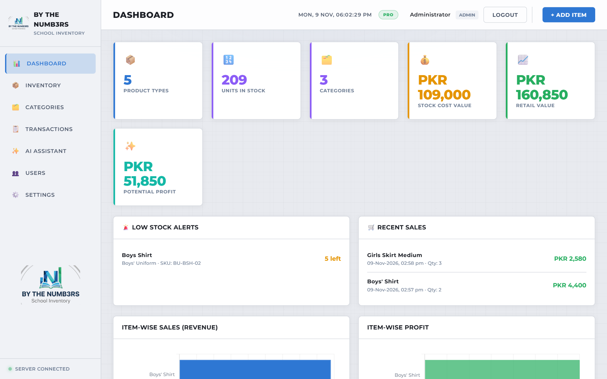
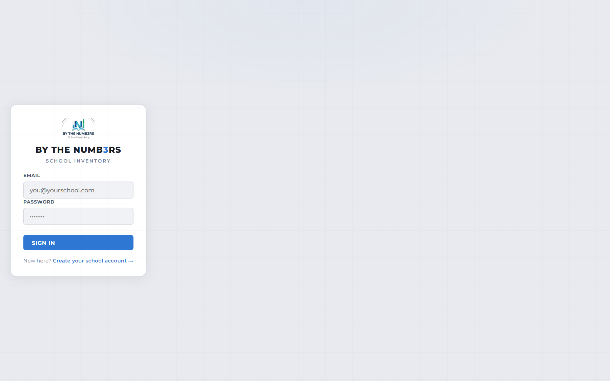
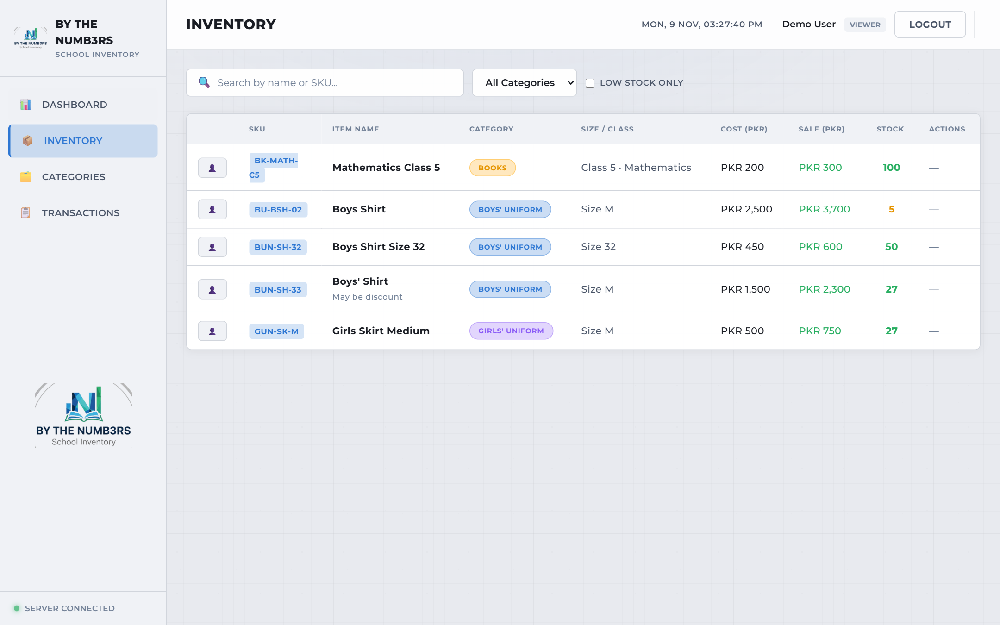
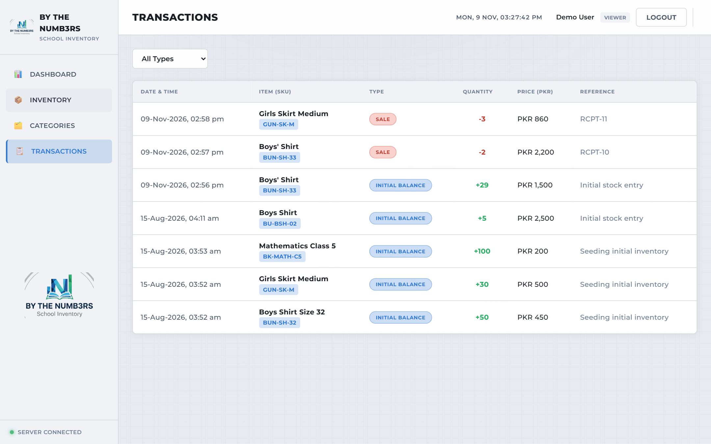

# School Inventory — BY THE NUMB3RS

A multi-tenant inventory and sales platform for schools, solo shops and retailers selling uniforms, books and supplies. Self-serve signup and an AI assistant grounded in your own data.

**Live:** https://btn-school-inv-7dh1.vercel.app/login.html
**Demo login:** `demo@school.local` / `demo1234` (read-only VIEWER account — safe to hand out)



| Login | Inventory | Transactions |
| --- | --- | --- |
|  |  |  |

## What it does

- **Multi-tenant SaaS** — every school gets its own isolated data; white-label school name + logo configurable per tenant
- **Self-serve signup** — create a school account in seconds, no approval flow
- **No paywalls (for now)** — every account gets full access, including AI; billing returns when a Pakistan-friendly payment provider is adopted
- **AI assistant (Groq/Llama 3.3)** — ask questions in plain English ("what's low in stock?"), 30-day analyst insights, reorder suggestions from 60-day sales velocity, auto-generated item descriptions
- **Dashboard** — stock units, stock cost vs retail value, potential profit, low-stock alerts, recent sales, item-wise revenue/profit charts
- **Inventory** — SKU, category, size/class, cost/sale price, stock balance, search, filters
- **Transactions ledger** — `INITIAL_BALANCE`, stock-in, `SALE`, with receipts and print support
- **Role-based access** — `ADMIN > MANAGER > STAFF > VIEWER`, enforced server-side
- **POS-style sale flow** — pick item → quantity → payment → printable receipt

## Tech stack

- **Backend:** Node.js, Express, Prisma ORM, Zod validation, helmet, express-rate-limit
- **Database:** PostgreSQL (Neon serverless in production; migrations + seeds reproducible locally)
- **Frontend:** Vanilla JS SPA (no build step), Chart.js, Montserrat
- **AI:** Groq API (Llama 3.3 70B), context built from the tenant's live DB
- **Hosting:** Vercel (serverless functions + static assets), Neon Postgres, GitHub auto-deploy on push
- **Tests:** `node:test` + embedded Postgres integration tests (11 passing), GitHub Actions CI

## Quick start (local)

Requires Node 22+.

```bash
npm install
cp .env.example .env       # defaults use a local Postgres
node scripts/dev-db.mjs    # embedded Postgres on :54329 (Ctrl+C to stop)
npx prisma migrate deploy
npm run seed               # demo data (admin@school.local / admin123)
npm start                  # http://localhost:3000
```

## Deployment (Vercel)

`npm run build` runs `prisma generate && prisma migrate deploy` — Vercel builds apply pending migrations automatically on every push. Required env vars:

| Variable | Purpose |
| --- | --- |
| `DATABASE_URL` | Runtime pooler connection (Neon) |
| `DIRECT_URL` | Unpooled direct connection for migrations |
| `SESSION_SECRET` | Session cookie signing |
| `NODE_ENV` | `production` in prod |
| `GROQ_API_KEY` | Enables AI features (console.groq.com) |

## Security & quality

- Cookie-session auth, bcrypt password hashing, httpOnly+secure cookies
- Same-origin enforcement, helmet CSP, rate limiting (API/auth/AI)
- Zod-validated inputs on all write endpoints, `@unique(tenantId, …)` + FK cascades
- Stock can never go negative (atomic conditional decrement in a DB transaction)
- 500s return generic messages; internals logged server-side
- Integration tests + CI on every push

## Roadmap

- Monetization via a Pakistan-friendly provider (SafePay / JazzCash / Easypaisa) once revenue justifies it
- CSV import/export for inventory
- Low-stock email notifications
- Multi-store support (one school, several branches)
- Audit log for inventory changes

## License

ISC
